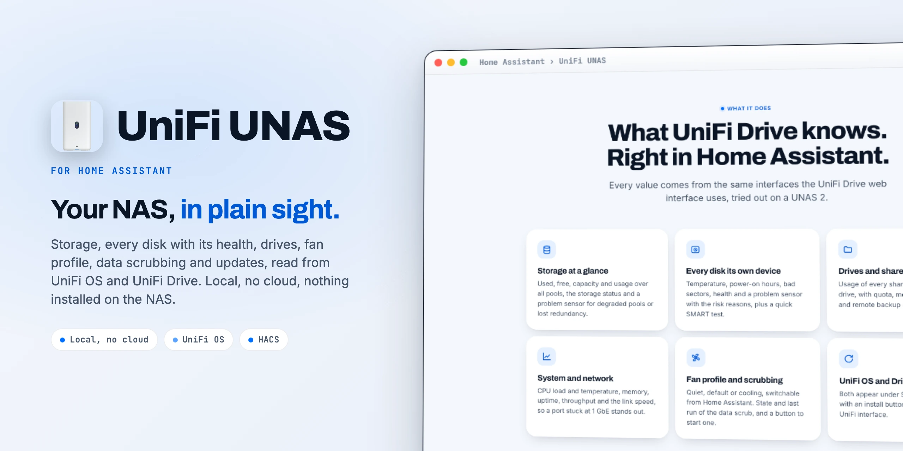
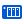

<div align="center">

<picture>
  <source media="(prefers-color-scheme: dark)" srcset="docs/images/readme-title-dark.webp" />
  
</picture>

<p>Your UniFi NAS in Home Assistant.<br/>
Storage, disks and health, local, no cloud.</p>

[](https://github.com/SH1FT-W/unifi-unas/releases/latest)
[](https://www.home-assistant.io)
[](https://hacs.xyz)
[](https://developers.home-assistant.io/docs/creating_integration_manifest/#iot-class)
[-006FFF?style=flat-square&labelColor=0B1526)](custom_components/unas/quality_scale.yaml)
[](LICENSE)

<p><a href="https://sh1ft-w.github.io/unifi-unas"><b>Website</b></a> &nbsp;·&nbsp; <a href="#new">New</a> &nbsp;·&nbsp; <a href="#features">Features</a> &nbsp;·&nbsp; <a href="#entities">Entities</a> &nbsp;·&nbsp; <a href="#installation">Install</a> &nbsp;·&nbsp; <a href="#security">Security</a> &nbsp;·&nbsp; <a href="#troubleshooting">Troubleshooting</a> &nbsp;·&nbsp; <a href="CHANGELOG.md">Changelog</a></p>

</div>

<br/>

UniFi UNAS brings a **UniFi NAS** into Home Assistant: storage, every disk with its health, drives and shares, system values, the fan profile, data scrubbing and the UniFi OS and Drive updates. It talks to UniFi OS and UniFi Drive on your own network, the same way their web interface does. No cloud account, no extra packages, nothing installed on the NAS.

> [!NOTE]
> UniFi UNAS is an independent project. It is not affiliated with, endorsed by or sponsored by Ubiquiti Inc. UniFi, UniFi OS, UniFi Drive and UNAS are trademarks of Ubiquiti Inc.

<br/>

<a id="new"></a>
<sub><b>JUST ARRIVED</b></sub>
## Display, night mode and your model.

<!-- cards:new -->
<table>
<tr><td width="34" valign="top"><picture><source media="(prefers-color-scheme: dark)" srcset="docs/images/icons/monitor-dark.svg"></picture></td><td width="46%" valign="top"><b>Display and night mode</b> <code>26.10.3</code><br>The UNAS display is a light with its brightness, the status LED can be turned off, and the night mode has a start and an end, as in UniFi OS.</td><td width="34" valign="top"><picture><source media="(prefers-color-scheme: dark)" srcset="docs/images/icons/image-outline-dark.svg"></picture></td><td width="46%" valign="top"><b>Your model's picture</b> <code>26.10.3</code><br>The UniFi OS and Drive updates show the product picture of your UNAS model, from Ubiquiti's public device catalog.</td></tr>
<tr><td width="34" valign="top"><picture><source media="(prefers-color-scheme: dark)" srcset="docs/images/icons/magnify-dark.svg"></picture></td><td width="46%" valign="top"><b>Found even when renamed</b> <code>26.10.3</code><br>A UNAS that no longer carries its default name is still discovered, through Home Assistant's network discovery.</td><td width="34" valign="top"><picture><source media="(prefers-color-scheme: dark)" srcset="docs/images/icons/certificate-outline-dark.svg"></picture></td><td width="46%" valign="top"><b>Remembers its certificate</b> <code>26.10.2</code><br>At setup the integration remembers the certificate the UNAS shows and only sends the password to that one. If it ever changes, a repair shows the old and the new fingerprint.</td></tr>
</table>
<!-- /cards:new -->

Every change, release by release, in the [changelog](CHANGELOG.md).

<a id="features"></a>
## Features

<!-- cards:features -->
<table>
<tr><td width="34" valign="top"><picture><source media="(prefers-color-scheme: dark)" srcset="docs/images/icons/harddisk-dark.svg"></picture></td><td width="46%" valign="top"><b>Storage at a glance</b><br>Used, free, capacity and usage over all pools, the storage status and a problem sensor for degraded pools or lost redundancy.</td><td width="34" valign="top"><picture><source media="(prefers-color-scheme: dark)" srcset="docs/images/icons/nas-dark.svg"></picture></td><td width="46%" valign="top"><b>Every disk its own device</b><br>Temperature, power-on hours, bad sectors, health and a problem sensor with the risk reasons, plus a quick SMART test.</td></tr>
<tr><td width="34" valign="top"><picture><source media="(prefers-color-scheme: dark)" srcset="docs/images/icons/folder-outline-dark.svg"></picture></td><td width="46%" valign="top"><b>Drives and shares</b><br>Usage of every shared and personal drive, with quota, members, snapshots and remote backup as attributes.</td><td width="34" valign="top"><picture><source media="(prefers-color-scheme: dark)" srcset="docs/images/icons/chart-line-dark.svg"></picture></td><td width="46%" valign="top"><b>System and network</b><br>CPU load and temperature, memory, uptime, network throughput and the link speed, so a port stuck at 1 GbE stands out.</td></tr>
<tr><td width="34" valign="top"><picture><source media="(prefers-color-scheme: dark)" srcset="docs/images/icons/fan-dark.svg"></picture></td><td width="46%" valign="top"><b>Fan profile</b><br>Quiet, default or cooling, switchable from Home Assistant, for example quiet at night.</td><td width="34" valign="top"><picture><source media="(prefers-color-scheme: dark)" srcset="docs/images/icons/shield-check-dark.svg"></picture></td><td width="46%" valign="top"><b>Data scrubbing</b><br>State and last run of the scrub, and a button to start one.</td></tr>
<tr><td width="34" valign="top"><picture><source media="(prefers-color-scheme: dark)" srcset="docs/images/icons/update-dark.svg"></picture></td><td width="46%" valign="top"><b>UniFi OS and Drive updates</b><br>Both appear under Settings, Updates, with an install button, just like in the UniFi interface.</td><td width="34" valign="top"><picture><source media="(prefers-color-scheme: dark)" srcset="docs/images/icons/lan-dark.svg"></picture></td><td width="46%" valign="top"><b>Local and discovered</b><br>Talks to UniFi OS on your network, no cloud account. A UNAS is discovered on its own, even after renaming it.</td></tr>
</table>
<!-- /cards:features -->

<a id="entities"></a>
## Entities

<!-- cards:entities -->
<table>
<tr><td width="34" valign="top"><picture><source media="(prefers-color-scheme: dark)" srcset="docs/images/icons/harddisk-dark.svg"></picture></td><td width="46%" valign="top"><b>Storage</b><br>storage_used, storage_free, storage_capacity, storage_usage, storage_status, storage_read and storage_write.</td><td width="34" valign="top"><picture><source media="(prefers-color-scheme: dark)" srcset="docs/images/icons/alert-circle-outline-dark.svg"></picture></td><td width="46%" valign="top"><b>Problems and health</b><br>storage_problem, disks_at_risk, hottest_disk, data_scrubbing and last_data_scrubbing.</td></tr>
<tr><td width="34" valign="top"><picture><source media="(prefers-color-scheme: dark)" srcset="docs/images/icons/nas-dark.svg"></picture></td><td width="46%" valign="top"><b>Per disk</b><br>temperature, power_on_hours, bad_sectors, health, problem and run_quick_smart_test, on a device per disk.</td><td width="34" valign="top"><picture><source media="(prefers-color-scheme: dark)" srcset="docs/images/icons/chart-line-dark.svg"></picture></td><td width="46%" valign="top"><b>System</b><br>cpu_load, cpu_temperature, memory_usage, started, network_receive, network_transmit and link_speed.</td></tr>
<tr><td width="34" valign="top"><picture><source media="(prefers-color-scheme: dark)" srcset="docs/images/icons/toggle-switch-outline-dark.svg"></picture></td><td width="46%" valign="top"><b>Services and controls</b><br>smb, time_machine and nfs as binary sensors, fan_profile as a select, restart, shut_down and start_data_scrubbing.</td><td width="34" valign="top"><picture><source media="(prefers-color-scheme: dark)" srcset="docs/images/icons/update-dark.svg"></picture></td><td width="46%" valign="top"><b>Updates</b><br>update.unas_2_unifi_os and update.unas_2_unifi_drive with the installed and the latest version.</td></tr>
</table>
<!-- /cards:entities -->

All IDs start with the device name, for example `sensor.unas_2_storage_used`. Every disk is a device of its own under the UNAS (`UNAS 2 disk 1`, SSDs are called `SSD 1`), every UniFi Drive drive gets a usage sensor named after it (`sensor.unas_2_media_used`). New disks and drives appear without a restart. Entity names are available in English and German.

The UNAS display is a light (`light.unas_2_display`, on/off and brightness), the status LED one more (`light.unas_2_status_led`, on/off), and the night mode has a start and an end (`time.unas_2_night_mode_start`, `time.unas_2_night_mode_end`). Changing them needs admin rights in UniFi OS. The two update entities show the product picture of your model, loaded from Ubiquiti's public device catalog.

<details>
<summary>All entity IDs (for a UNAS named "UNAS 2" with English names)</summary>

```
sensor.unas_2_storage_used            sensor.unas_2_storage_free
sensor.unas_2_storage_capacity        sensor.unas_2_storage_usage
sensor.unas_2_storage_status          sensor.unas_2_storage_read
sensor.unas_2_storage_write           sensor.unas_2_disks_at_risk
sensor.unas_2_hottest_disk            sensor.unas_2_data_scrubbing
sensor.unas_2_last_data_scrubbing     sensor.unas_2_cpu_load
sensor.unas_2_cpu_temperature         sensor.unas_2_memory_usage
sensor.unas_2_started                 sensor.unas_2_network_receive
sensor.unas_2_network_transmit        sensor.unas_2_link_speed
sensor.unas_2_unifi_drive_version     (disabled by default)
sensor.unas_2_<drive>_used            one per drive
binary_sensor.unas_2_storage_problem
binary_sensor.unas_2_smb              binary_sensor.unas_2_time_machine
binary_sensor.unas_2_nfs
select.unas_2_fan_profile
button.unas_2_restart                 button.unas_2_shut_down (disabled by default)
button.unas_2_start_data_scrubbing
update.unas_2_unifi_os                update.unas_2_unifi_drive

Per disk (here disk 1):
sensor.unas_2_disk_1_temperature      sensor.unas_2_disk_1_power_on_hours
sensor.unas_2_disk_1_bad_sectors      sensor.unas_2_disk_1_health
sensor.unas_2_disk_1_read_rate        sensor.unas_2_disk_1_write_rate (both disabled by default)
sensor.unas_2_disk_1_uncorrectable_sectors (disabled by default)
binary_sensor.unas_2_disk_1_problem   button.unas_2_disk_1_run_quick_smart_test
```

</details>

### Health

**Health** translates the health score of UniFi Drive into words: **Good** is 5, the highest score, **Check** is anything below. The number itself is in the attribute `score` (`5 / 5`). UniFi Drive does not say what the scores 1 to 4 mean, so there are only these two levels. When a disk shows Check, look at it in UniFi Drive under Storage.

The **problem** sensor of a disk turns on as soon as Drive no longer lists it as optimal or reports risk reasons (attribute `risk_reasons`). **Storage problem** turns on when a pool is degraded, rebuilding, failed or has lost its redundancy (attribute `redundancy`).

<a id="installation"></a>
## Installation

### HACS (custom repository)

[](https://my.home-assistant.io/redirect/hacs_repository/?owner=SH1FT-W&repository=unifi-unas&category=integration)

1. In HACS, open the three dots menu, choose **Custom repositories** and add `https://github.com/SH1FT-W/unifi-unas` with the type **Integration**.
2. Search for **UniFi UNAS**, download it and restart Home Assistant.

### Manual

1. Download the [latest release](https://github.com/SH1FT-W/unifi-unas/releases/latest).
2. Copy the folder `custom_components/unas` into `/config/custom_components/` and restart Home Assistant.

Requires Home Assistant 2026.9 or newer.

## Setup

1. In UniFi OS, create a **local** user (not a UI account with two-factor login) with access to UniFi Drive. That is enough for every value. Only restart, shutdown and the updates need **admin rights in UniFi OS** as well.
2. Home Assistant usually finds the UNAS on its own (**Settings > Devices & services > Discovered**), then enter username and password. Discovery uses the SMB announcement with the default name `UNAS-…`; a renamed UNAS is added by hand.
3. Otherwise choose **Add integration > UniFi UNAS** and enter address, username and password.

| Field | Meaning |
|:--|:--|
| Host | IP address or host name of the UNAS |
| Username / password | the local UniFi OS account |
| Verify certificate | off by default, see [Security](#security). Turn it on only if the UNAS has a certificate from a trusted authority. |

New address or another account later: **three dots > Reconfigure**. Switch **Verify certificate** later: **Configure** (the connection is tested first). If the UNAS rejects the login (password changed), Home Assistant asks for new credentials on its own.

<a id="security"></a>
## Security

- **The password only goes to your UNAS.** UniFi OS uses a self-signed certificate, so the integration remembers the certificate the UNAS shows at setup and from then on only talks to a UNAS with exactly that certificate (trust on first use). If the certificate changes, the integration stops and **Settings > Repairs** shows the old and the new fingerprint. That is normal after a factory reset, a reinstall of UniFi OS or a renewed certificate. If you changed nothing, do not accept it: something else may be answering at that address. You can compare the fingerprint with the certificate your browser shows for the UNAS.
- **Least privilege.** For monitoring, a local account with access to UniFi Drive is enough. Admin rights in UniFi OS are only needed for restart, shutdown and installing updates. Without them these buttons report that the account lacks the rights, everything else keeps working.
- **Shut down** is disabled by default: afterwards the UNAS can only be switched on with its power button.
- **Diagnostics** leave out address, credentials, MAC address and serial numbers.

## Data updates

Every 30 seconds: system, storage, disks, drives, network and fan. Every 5 minutes: firmware status, services and storage throughput (the UNAS only computes it in five minute steps anyway). After every command there is an extra refresh a few seconds later; the fan profile shows the new value right away.

While the UNAS restarts or installs an update, its values are briefly unavailable and come back on their own. Home Assistant only asks for new credentials when the UNAS really rejects the login.

## Supported devices

Tested with the **UNAS 2** (UniFi OS 6.0.11, UniFi Drive 4.4.17). It should work with every UNAS model running UniFi Drive (UNAS 4, UNAS Pro, Pro 4, Pro 8), they share the same interface, but these are untested. Feedback is welcome as an [issue](https://github.com/SH1FT-W/unifi-unas/issues) with the diagnostics file attached.

## Examples

Get a push when a disk reports a problem:

```yaml
triggers:
  - trigger: state
    entity_id:
      - binary_sensor.unas_2_disk_1_problem
      - binary_sensor.unas_2_disk_2_problem
    to: "on"
actions:
  - action: notify.mobile_app_phone
    data:
      message: "UNAS: {{ trigger.to_state.name }} ({{ trigger.to_state.attributes.risk_reasons | join(', ') }})"
```

Warn when storage gets full:

```yaml
triggers:
  - trigger: numeric_state
    entity_id: sensor.unas_2_storage_usage
    above: 85
actions:
  - action: notify.mobile_app_phone
    data:
      message: "UNAS storage is above 85 %."
```

More ideas: fan profile Quiet at night, a monthly data scrub, a notification when `sensor.unas_2_link_speed` is not `2.5 GbE`.

## Known limitations

- **Unofficial interface.** Ubiquiti offers no public API for UniFi Drive, so the integration uses the interfaces of the Drive web interface. A Drive update can change them; the entities then turn unavailable and the diagnostics show the error.
- **No API key.** UniFi OS API keys were tested on a UNAS 2 and only cover part of the data, so the integration logs in with a local account:

  | Reading | API key | Local account |
  |:--|:--:|:--:|
  | Storage, pools, disks, health | yes | yes |
  | CPU, memory, network, fan profile | yes | yes |
  | SMB, Time Machine, NFS | yes | yes |
  | Usage per drive | no | yes |
  | UniFi OS and Drive updates | no | yes |
  | Storage throughput | no | yes |
  | Fan profile switching and all buttons | no | yes |

- **Data scrubbing** (button and last run) refers to the first storage pool. A UNAS 2 has exactly one; models with several pools get no button per pool yet.
- **SSD cache** of the Pro models is not shown separately.
- **Snapshots, shares, remote backup and users** are not managed. Snapshot and remote backup status per drive are shown as attributes.
- **Installing updates** is called the same way the UniFi interface does it; the install itself is only verified once an update shows up.

<a id="troubleshooting"></a>
## Troubleshooting

- **"Username or password is wrong".** Is it a local account? UI accounts with two-factor login do not work. After several failed attempts UniFi OS locks logins for a short while (HTTP 429).
- **"Login works, but the account has no access to UniFi Drive".** Give the user access to UniFi Drive in UniFi OS.
- **Restart or updates report that the account lacks the rights.** The user needs admin rights in UniFi OS.
- **Repair "certificate changed".** See [Security](#security).
- **All entities "unavailable".** The UNAS does not answer at its address. Check its IP address and use **three dots > Reconfigure**.
- **Diagnostics:** **Settings > Devices & services > UniFi UNAS > three dots > Download diagnostics**. Address, MAC address and serial numbers are left out.
- **Debug log:**

  ```yaml
  logger:
    logs:
      custom_components.unas: debug
  ```

When you open an [issue](https://github.com/SH1FT-W/unifi-unas/issues), please attach the diagnostics file.

## Removal

1. **Settings > Devices & services > UniFi UNAS > three dots > Delete.**
2. Delete the folder `/config/custom_components/unas` (or remove the repository in HACS) and restart Home Assistant.

Nothing stays on the UNAS except the user you created for it.

<details>
<summary><b>Development</b></summary>
<br/>

```bash
python -m pytest -q -p no:logging        # simulated UNAS in tests/conftest.py, no real NAS needed
uvx ruff check . && uvx ruff format --check .
uvx mypy@2.3.1 --python-executable <venv>/bin/python
python tools/pruefe-uebersetzungen.py    # strings.json against translations/*.json
```

Install the test requirements into a virtual environment with `pip install -r requirements_test.txt`. The same checks run on GitHub Actions for every push and pull request, plus HACS validation and hassfest. Notes on the UniFi OS and Drive interfaces are in [`CLAUDE.md`](CLAUDE.md) (German).

</details>

<details>
<summary><b>Versions</b></summary>
<br/>

UniFi UNAS uses calendar versions **`YY.M.N`**: year, month, and the number of the release within that month. `26.10.2` is the second release of October 2026. Tags, release titles and the version badge are just the number, without a leading "v".

</details>

## License

[Apache License 2.0](LICENSE), Copyright 2026 SH1FT-W.

<br/>

<div align="center">
  <sub>A <a href="https://sh1ft-w.github.io"><b>SH1FT-W</b></a> project &nbsp;·&nbsp; <a href="https://sh1ft-w.github.io/casora">Casora</a> &nbsp;·&nbsp; <a href="https://sh1ft-w.github.io/flode">FLODE</a> &nbsp;·&nbsp; <a href="https://sh1ft-w.github.io/pulse">Pulse</a> &nbsp;·&nbsp; <a href="https://sh1ft-w.github.io/jbl-bar">JBL Bar</a> &nbsp;·&nbsp; <a href="https://sh1ft-w.github.io/agentbar">AgentBar</a> &nbsp;·&nbsp; Built with <a href="https://claude.ai">Claude</a></sub>
</div>
