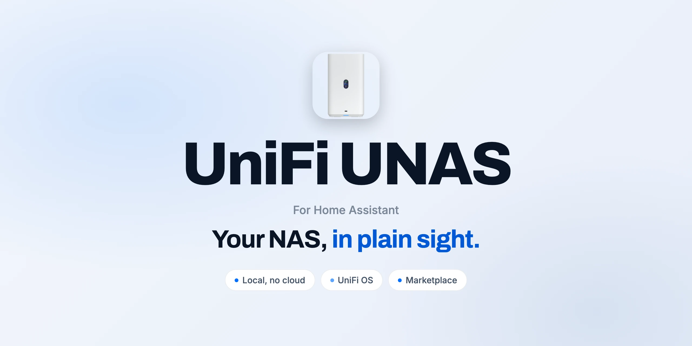

<div align="center">

<picture>
  <source media="(prefers-color-scheme: dark)" srcset="docs/images/readme-title-dark.webp" />
  
</picture>

[](https://github.com/SH1FT-W/unifi-unas/releases/latest)
[](https://www.home-assistant.io)
[](https://hacs.xyz)

<a href="https://sh1ft-w.github.io/unifi-unas"><b>Website</b></a>&emsp;<a href="#install">Install</a>&emsp;<a href="#set-up">Set up</a>&emsp;<a href="#entities">Entities</a>&emsp;<a href="CHANGELOG.md">Changelog</a>

</div>

<br/>

Your UniFi NAS in Home Assistant: **storage, every disk with its health, drives, system values, fan profile, data scrubbing and the UniFi OS and Drive updates.** It talks to UniFi OS and UniFi Drive on your own network, the way their web interface does. No cloud account, nothing installed on the NAS.

Ubiquiti offers no public API for UniFi Drive, so a Drive update can change what the integration reads. It is tested on a **UNAS 2**; UNAS 4, UNAS Pro, Pro 4 and Pro 8 share the same interface but are untested.

## Which account for what

|  | Local Drive user | With UniFi OS admin |
|:--|:--:|:--:|
| Storage, pools, disks and health | ✓ | ✓ |
| Usage per drive, system and network values | ✓ | ✓ |
| Fan profile, data scrubbing, SMART tests | ✓ | ✓ |
| Update available for UniFi OS and Drive | ✓ | ✓ |
| Display, status LED and night mode | shown | ✓ |
| Restart, shut down, install updates | | ✓ |

Without admin rights these buttons say the account lacks the rights; everything else keeps working.

**New in 26.11:** a problem sensor per storage pool with a repair notice while a RAID is damaged, and an extended SMART test per disk. Every change is in the [changelog](CHANGELOG.md).

<a id="install"></a>
## Install

[](https://my.home-assistant.io/redirect/hacs_repository/?owner=SH1FT-W&repository=unifi-unas&category=integration)

Search for **UniFi UNAS** under **Settings > Marketplace** (called HACS before Home Assistant 2026.11), download it and restart Home Assistant.

<details>
<summary>Install by hand</summary>

1. Download the [latest release](https://github.com/SH1FT-W/unifi-unas/releases/latest).
2. Copy `custom_components/unas` into `/config/custom_components/` and restart Home Assistant.

</details>

<a id="set-up"></a>
## Set up

You need a **local** UniFi OS user with access to UniFi Drive. UI accounts with two-factor login do not work.

1. **Create the user** in UniFi OS. Give it admin rights only if you want the buttons from the table above.
2. **Add the UNAS.** It usually shows up under **Settings > Devices & services > Discovered**, even after renaming it. If not, choose **Add integration > UniFi UNAS** and enter its IP address or host name.
3. **Enter username and password.** Leave **Verify certificate** off unless the UNAS has a certificate from a trusted authority (see [Your data](#your-data)).

New address or another account: **three dots > Reconfigure**. Verify certificate: **Configure**. If the UNAS rejects the password later, Home Assistant asks for new credentials by itself.

<a id="entities"></a>
## Entities

IDs for a UNAS named "UNAS 2". Names are in English and German. New disks and drives appear without a restart.

| Entity | Shows |
|:--|:--|
| `sensor.unas_2_storage_used`, `_free`, `_capacity`, `_usage`, `_status` | Storage over all pools |
| `binary_sensor.unas_2_storage_problem` | On when a pool is degraded, rebuilding, failed or lost its redundancy |
| `binary_sensor.unas_2_storage_pool_1` | One per pool. Problem while the RAID is damaged, then a notice under **Settings > Repairs** |
| `sensor.unas_2_disk_1_health` | One device per disk. **Good** is Drive's top score 5, **Check** anything below (attribute `score`) |
| `binary_sensor.unas_2_disk_1_problem` | On when Drive no longer lists the disk as optimal, attribute `risk_reasons` |
| `sensor.unas_2_disk_1_temperature`, `_power_on_hours`, `_bad_sectors` | Per disk |
| `button.unas_2_disk_1_run_quick_smart_test`, `_run_extended_smart_test` | A few minutes or several hours. Drive shows the result |
| `sensor.unas_2_<drive>_used` | One per drive, with quota, members, snapshots and remote backup as attributes |
| `select.unas_2_fan_profile` | Quiet, default or cooling |
| `update.unas_2_unifi_os`, `update.unas_2_unifi_drive` | Installed against latest version, with your model's picture |

<details>
<summary>More entities</summary>

| Entity | Shows |
|:--|:--|
| `sensor.unas_2_storage_read`, `_storage_write` | Throughput of all disks, average of 5 minutes |
| `sensor.unas_2_disks_at_risk`, `_hottest_disk` | Count and temperature |
| `sensor.unas_2_data_scrubbing`, `_last_data_scrubbing` | State and last run of the scrub (first pool) |
| `sensor.unas_2_cpu_load`, `_cpu_temperature`, `_memory_usage`, `_started` | System |
| `sensor.unas_2_network_receive`, `_network_transmit`, `_link_speed` | Network, so a port stuck at 1 GbE stands out |
| `binary_sensor.unas_2_smb`, `_time_machine`, `_nfs` | Services |
| `light.unas_2_display`, `light.unas_2_status_led` | Display with brightness, status LED on or off |
| `time.unas_2_night_mode_start`, `_night_mode_end` | Night mode, as in UniFi OS |
| `button.unas_2_restart`, `_start_data_scrubbing` | |
| `button.unas_2_shut_down` | Disabled by default: afterwards only the power button switches it on |
| `sensor.unas_2_unifi_drive_version` | Disabled by default |
| `sensor.unas_2_disk_1_read_rate`, `_write_rate`, `_uncorrectable_sectors` | Per disk, disabled by default |

</details>

## Examples

Get a push when a disk reports a problem:

```yaml
triggers:
  - trigger: state
    entity_id:
      - binary_sensor.unas_2_disk_1_problem
      - binary_sensor.unas_2_disk_2_problem
    to: "on"
actions:
  - action: notify.mobile_app_phone
    data:
      message: "UNAS: {{ trigger.to_state.name }} ({{ trigger.to_state.attributes.risk_reasons | join(', ') }})"
```

<details>
<summary>Warn when storage gets full</summary>

```yaml
triggers:
  - trigger: numeric_state
    entity_id: sensor.unas_2_storage_usage
    above: 85
actions:
  - action: notify.mobile_app_phone
    data:
      message: "UNAS storage is above 85 %."
```

</details>

<a id="your-data"></a>
## Your data

- **The password only goes to your UNAS.** UniFi OS uses a self-signed certificate, so the integration remembers the one the UNAS shows at setup and talks to nothing else. If it changes, **Settings > Repairs** shows the old and the new fingerprint. Accept it after a factory reset, a reinstall or a renewed certificate; if you changed nothing, do not.
- **The only internet access** is the product picture of your model from Ubiquiti's public device catalog, at most once a week.
- **Diagnostics leave out** address, credentials, MAC address and serial numbers.

## Good to know

- No API key: on a UNAS 2 it misses drive usage, updates and throughput and cannot switch anything, so the integration logs in with a local account.
- UniFi Drive does not say what the health scores 1 to 4 mean, hence only Good and Check. A pool state the integration has not seen yet makes the pool sensor unknown instead of raising an alarm.
- Data scrubbing refers to the first pool. The SSD cache of the Pro models is not shown separately.
- Snapshots, shares, remote backup and users are not managed. Installing updates is called like the UniFi interface does it, but is only verified once an update shows up.

<details>
<summary>Troubleshooting</summary>

- **"Username or password is wrong".** Is it a local account? After several failed attempts UniFi OS locks logins for a short while (HTTP 429).
- **"Login works, but the account has no access to UniFi Drive".** Give the user access to UniFi Drive in UniFi OS.
- **Repair "storage pool is damaged".** A disk of the RAID failed or is missing. Replace it in UniFi Drive under Storage; the notice goes away by itself.
- **All entities unavailable.** The UNAS does not answer at its address. Use **three dots > Reconfigure**. During a restart or an update the values are briefly unavailable and come back on their own.
- **Debug log:**

  ```yaml
  logger:
    logs:
      custom_components.unas: debug
  ```

When you open an [issue](https://github.com/SH1FT-W/unifi-unas/issues), attach the diagnostics (**Settings > Devices & services > UniFi UNAS > three dots > Download diagnostics**).

</details>

<details>
<summary>Remove</summary>

1. **Settings > Devices & services > UniFi UNAS > three dots > Delete**.
2. Remove the repository in the Marketplace (or delete `/config/custom_components/unas`) and restart Home Assistant.

Nothing stays on the UNAS except the user you created for it.

</details>

<details>
<summary>How it works</summary>

| What | How often |
|:--|:--|
| System, storage, disks, drives, network, fan | every 30 seconds |
| Firmware, services, storage throughput | every 5 minutes (the UNAS computes throughput in 5 minute steps) |
| After a command | one extra refresh a few seconds later |

Everything goes over HTTPS to UniFi OS and UniFi Drive, using the interfaces of the Drive web interface. Discovery uses the SMB announcement of the UNAS and Home Assistant's DHCP discovery. Notes on the interfaces are in [`CLAUDE.md`](CLAUDE.md) (German).

</details>

<details>
<summary>Development</summary>

```bash
python -m pytest -q -p no:logging        # simulated UNAS in tests/conftest.py, no real NAS needed
uvx ruff check . && uvx ruff format --check .
uvx mypy@2.3.1 --python-executable <venv>/bin/python
python tools/pruefe-uebersetzungen.py    # strings.json against translations/*.json
```

Test requirements: `pip install -r requirements_test.txt`. GitHub Actions runs the same checks plus HACS validation and hassfest. Quality scale: platinum, [self-assessed](custom_components/unas/quality_scale.yaml).

</details>

## License

[Apache License 2.0](LICENSE). Copyright 2026 SH1FT-W.

<sub>UniFi UNAS is an independent project, not affiliated with, endorsed or sponsored by Ubiquiti Inc. UniFi, UniFi OS, UniFi Drive and UNAS are trademarks of Ubiquiti Inc.</sub>
